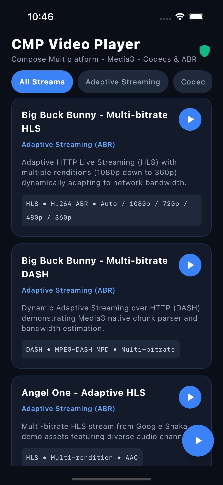
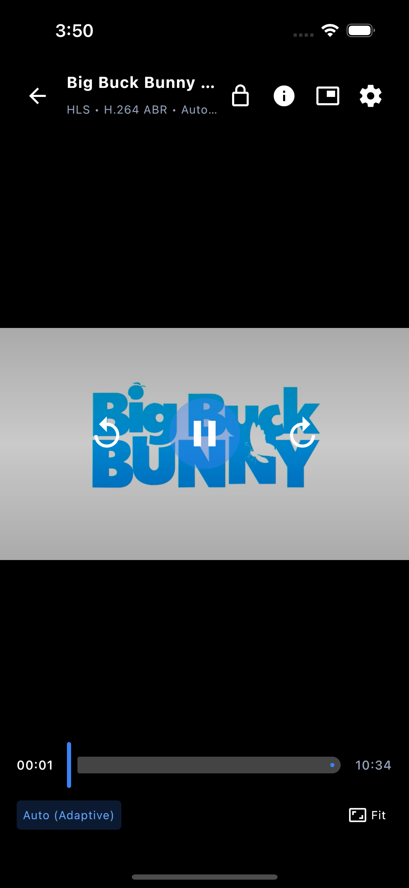
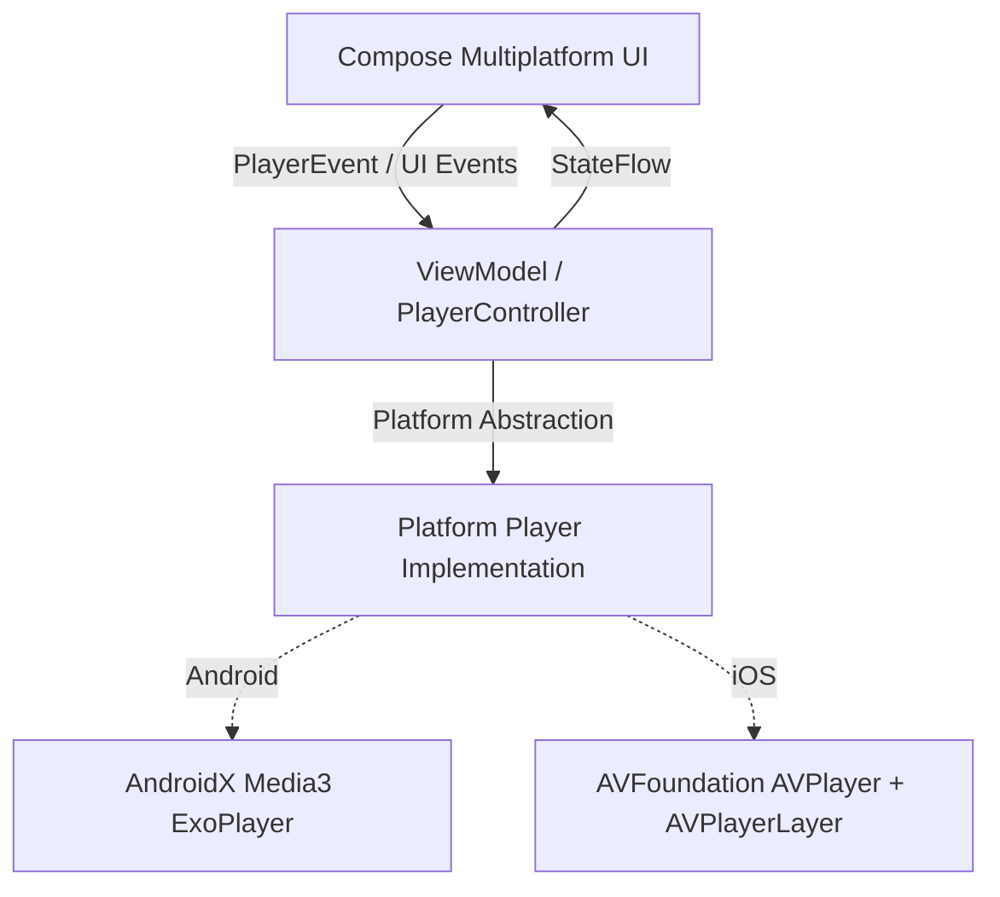

# CMP Video Player

[](https://github.com/chinmaybhardwaj/VideoPlayerApp/actions/workflows/android.yml)
[](https://github.com/chinmaybhardwaj/VideoPlayerApp/actions/workflows/ios.yml)
[](https://kotlinlang.org)
[](https://www.jetbrains.com/lp/compose-multiplatform/)
[](LICENSE)

A modern, high-performance, cross-platform video player application built with **Kotlin Multiplatform (KMP)** and **Compose Multiplatform (CMP)** targeting **Android** and **iOS**. 

The app features a unified Compose UI design system paired with native hardware-accelerated playback engines (**AndroidX Media3 ExoPlayer** on Android and **AVFoundation AVPlayer** on iOS).

---

## 📱 Screenshots

| Video Feed & Catalog Screen | Video Player & OTT Controls |
|:---:|:---:|
|  |  |

---

## ✨ Features & Functionality

### 🎬 Professional OTT Controls & Gestures
- **Animated Controls Overlay**: Smooth fade-in/fade-out on tap with intelligent 4-second auto-dismissal during active playback.
- **Gesture Seeking**: Double-tap left or right to seek backwards or forwards by 10 seconds with animated notice badges (`-10s` / `+10s`).
- **Interactive Scrubber**: Live scrub preview with formatted duration timestamps (`MM:SS` or `HH:MM:SS`) and buffer progress visualization.
- **Screen Lock Mode**: One-tap lock toggle disables touch controls and gestures to prevent accidental touches during viewing.
- **Aspect Ratio Cycling**: Dynamic cycle through `FIT` (aspect fit / letterbox), `FILL` (aspect fill / zoom-crop), `FIXED_16_9`, and `STRETCH`.

### 📊 "Stats for Nerds" Real-Time Telemetry HUD
- Real-time diagnostics overlay displaying:
  - Resolution and frame dimensions
  - Current video bitrate and audio bitrate
  - Buffer health (buffered duration in milliseconds and buffer percentage)
  - Dropped frames count
  - Active video & audio MIME codecs (e.g., `video/avc`, `video/hevc`, `video/av01`, `audio/mp4a-latm`)
  - Playback engine state

### 🛡️ DRM & Content Security
- **Dynamic Screen Capture Protection**: Automatically toggles `FLAG_SECURE` on Android when protected DRM content is playing to prevent screen recording and screenshots.
- **In-App DRM & Security Guide**: Built-in educational guide explaining Widevine, FairPlay, PlayReady, ClearKey, and modern media protection architectures.

### 🖼️ Picture-in-Picture (PiP)
- Built-in support for seamless Picture-in-Picture floating window playback, allowing users to multitask without interrupting media playback.

### 🔗 Custom Stream URL Player
- Floating Action Button on the catalog screen opens a custom stream launcher supporting instant playback of any valid HLS, DASH, or progressive video URL.

---

## 📺 Supported Video Playback Options & Formats

| Category | Stream Type | Codecs & Formats | Details |
|:---|:---|:---|:---|
| **Adaptive Streaming (ABR)** | **HLS** (`.m3u8`) | H.264 (AVC) / AAC | Multi-bitrate Apple HTTP Live Streaming with dynamic quality ladders from 1080p down to 360p adapting to real-time bandwidth. |
| **Adaptive Streaming (ABR)** | **MPEG-DASH** (`.mpd`) | H.264 (AVC) / AAC | Dynamic Adaptive Streaming over HTTP featuring chunk parsing and bandwidth estimation. |
| **Modern Video Codecs** | **HEVC / H.265** (`.mp4`) | H.265 (HEVC) / AAC | High Efficiency Video Coding providing 50% bandwidth savings compared to AVC. |
| **Modern Video Codecs** | **VP9** (`.webm`) | VP9 / Opus | Google open-source video codec optimized for efficient web and mobile streaming. |
| **Modern Video Codecs** | **AV1** (`.mp4`) | AV1 (`video/av01`) / Opus | Next-generation royalty-free video compression with exceptional visual quality. |
| **Multi-Track Media** | **Multi-Audio & Subtitles** | Dual Audio / WebVTT | Streams featuring multiple alternate audio channels (e.g., English, Spanish) and Closed Caption (CC) subtitle tracks. |
| **DRM & Protected Media** | **ClearKey DRM** | CENC / Common Encryption | Demonstrates encrypted media pipeline, license acquisition workflows, and secure playback handling. |

---

## 🏗️ Architecture & Tech Stack

This project adheres to official Android & Kotlin Multiplatform architecture guidelines, utilizing an **MVI (Model-View-Intent) / UDF (Unidirectional Data Flow)** pattern:



### Module Breakdown

```
VideoPlayerApp/
├── app/                        # Android application entry point (MainActivity, PiP setup)
├── iosApp/                     # iOS native Xcode project & SwiftUI/UIKit host
├── composeApp/                 # Shared Compose UI screens, view models, & platform surfaces
│   ├── commonMain/             # App composable, CatalogScreen, PlayerScreen, Dialogs
│   ├── androidMain/            # Android-specific Compose integrations & ViewModels
│   └── iosMain/                # iOS MainViewController & UIKitView player wrapper
└── core/
    ├── model/                  # Domain entities (Video, VideoCategory, ResizeMode, TrackInfo)
    ├── player/                 # Playback abstraction (PlayerController, PlayerState, PlayerEvent)
    │   ├── commonMain/         # Interface & shared contracts
    │   ├── androidMain/        # ExoPlayerController (Media3 implementation)
    │   └── iosMain/            # IosPlayerController (AVPlayer implementation)
    └── designsystem/           # Custom Dark Theme, PlayerIcons, HUD overlays, Sliders
```

### Technology Highlights

- **UI Framework**: [Compose Multiplatform](https://www.jetbrains.com/lp/compose-multiplatform/) 1.8.0
- **Android Playback**: [AndroidX Media3 ExoPlayer](https://developer.android.com/media/media3) 1.5.1
- **iOS Playback**: [AVFoundation](https://developer.apple.com/documentation/avfoundation) (native `AVPlayer` & `AVPlayerLayer` embedded via Compose `UIKitView`)
- **Dependency Injection**: [Koin Multiplatform](https://insert-koin.io/) 4.0.2 (`koin-compose`, `koin-compose-viewmodel`)
- **Coroutines & Asynchronous Programming**: [Kotlinx Coroutines](https://github.com/Kotlin/kotlinx.coroutines) 1.11.0
- **Continuous Integration**: [GitHub Actions](https://github.com/features/actions) running automated Android and iOS simulator builds on every commit.

---

## 🚀 Getting Started

### Prerequisites

- **JDK 17** (e.g., Eclipse Temurin or Azul Zulu)
- **Android Studio** (Ladybug / Meerkat or later) with Android SDK 35/37
- **Xcode 16+** (for building and running the iOS application on macOS)
- **CocoaPods / Xcode Command Line Tools**

### 🤖 Running the Android App

1. Clone the repository:
   ```bash
   git clone https://github.com/chinmaybhardwaj/VideoPlayerApp.git
   cd VideoPlayerApp
   ```
2. Build and assemble the debug APK:
   ```bash
   ./gradlew assembleDebug
   ```
3. Run unit tests:
   ```bash
   ./gradlew testDebugUnitTest
   ```
4. Or open the project in Android Studio, select the `app` configuration, and click **Run**.

### 🍏 Running the iOS App (Simulator)

1. Pre-compile the shared Kotlin Multiplatform debug framework:
   ```bash
   ./gradlew :composeApp:linkDebugFrameworkIosSimulatorArm64
   ```
2. Build the Xcode project for your booted iOS simulator:
   ```bash
   # Build with xcodebuild
   xcodebuild -project iosApp/iosApp.xcodeproj \
     -scheme iosApp \
     -configuration Debug \
     -destination "generic/platform=iOS Simulator" \
     CODE_SIGNING_ALLOWED=NO \
     build
   ```
3. Alternatively, open `iosApp/iosApp.xcodeproj` in Xcode, select an iOS Simulator (e.g. iPhone 16), and press **Cmd + R**.

---

## 🤝 Contributing

Contributions, bug reports, and feature suggestions are welcome! Feel free to open an issue or submit a pull request.

---

## 📄 License

This project is licensed under the Apache License 2.0 - see the [LICENSE](LICENSE) file for details.
